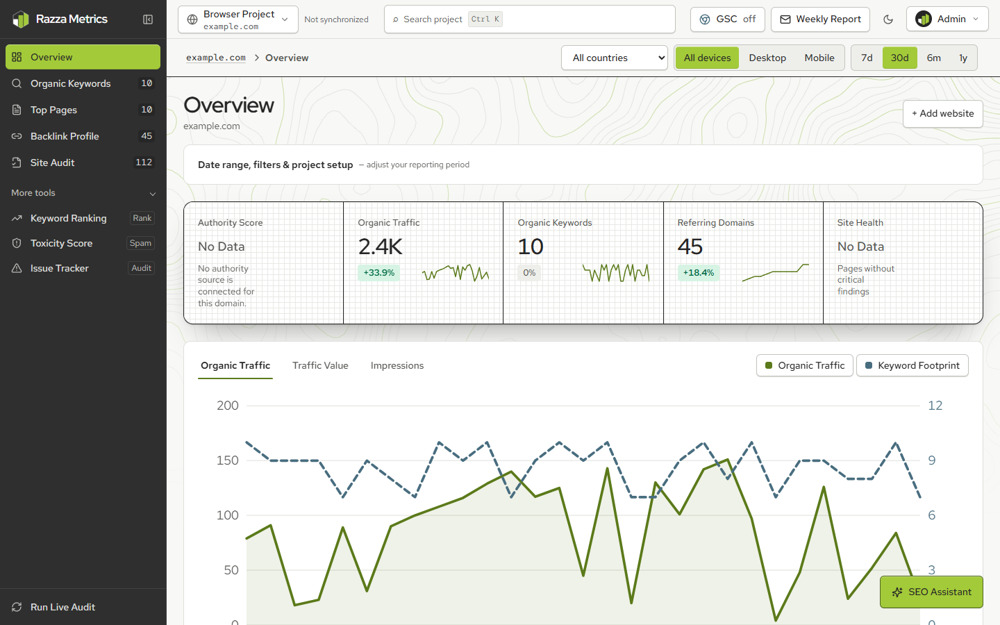
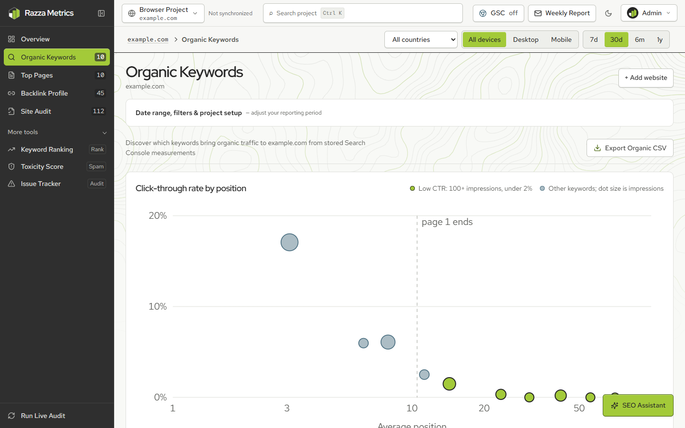
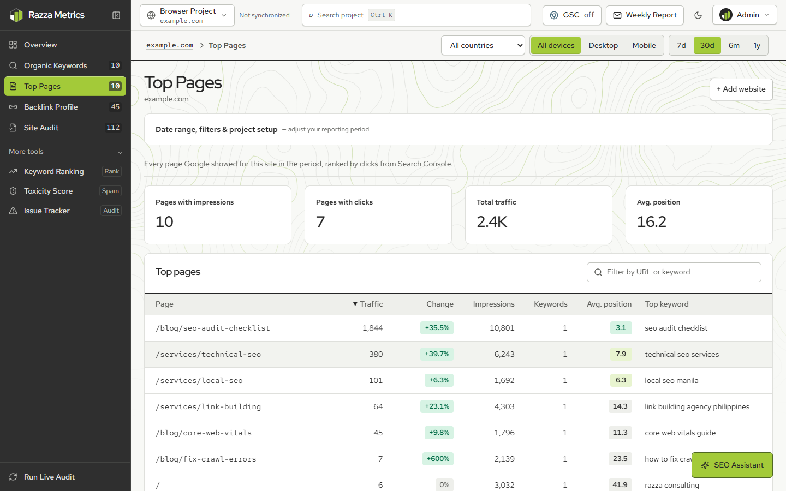
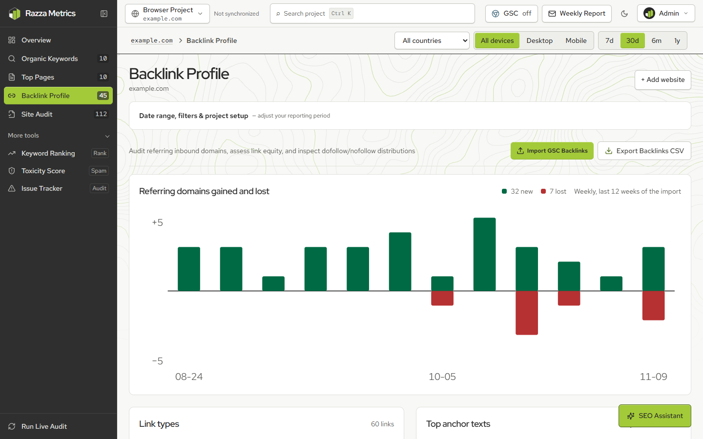
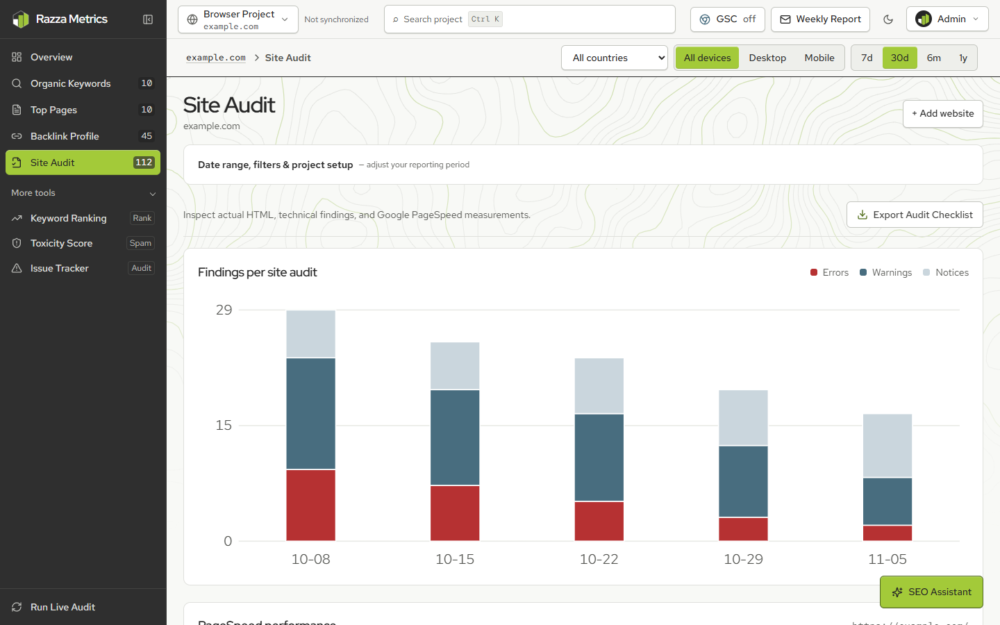
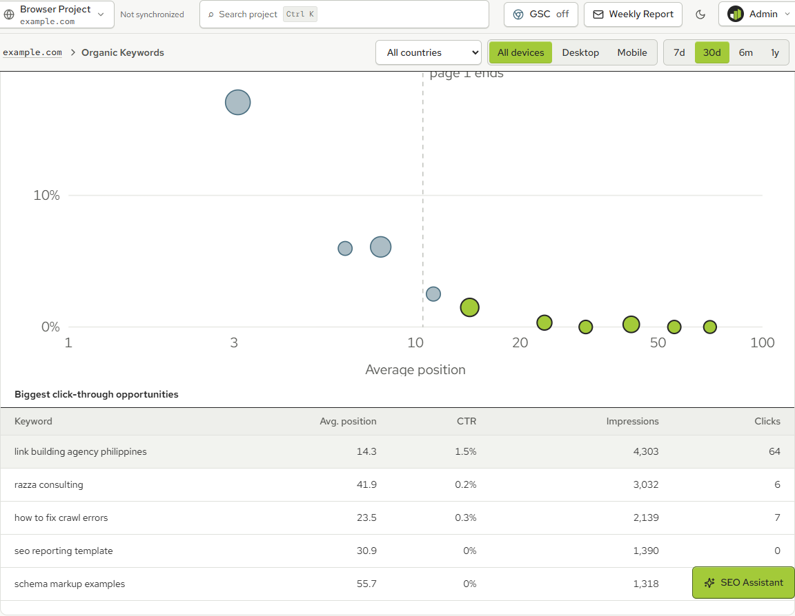
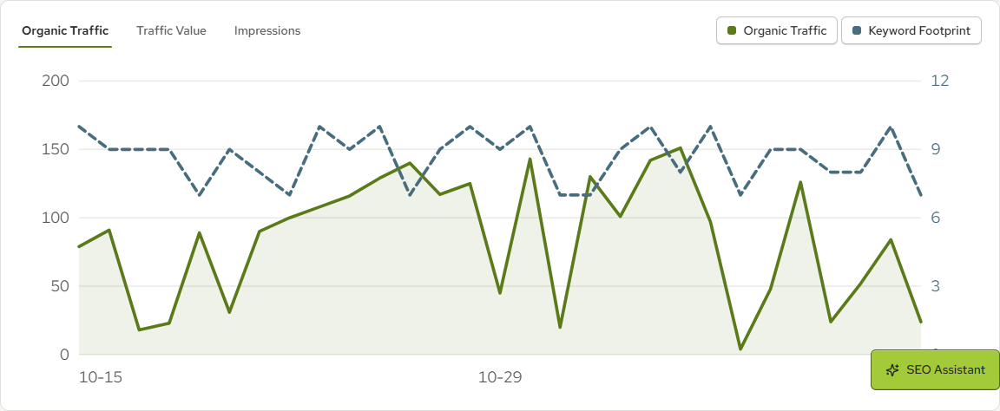
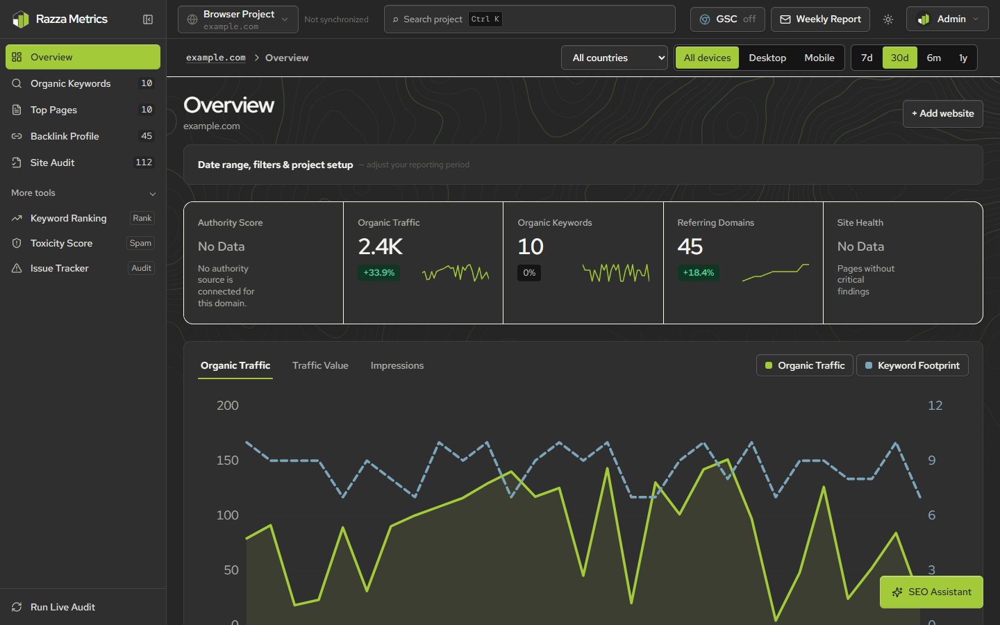
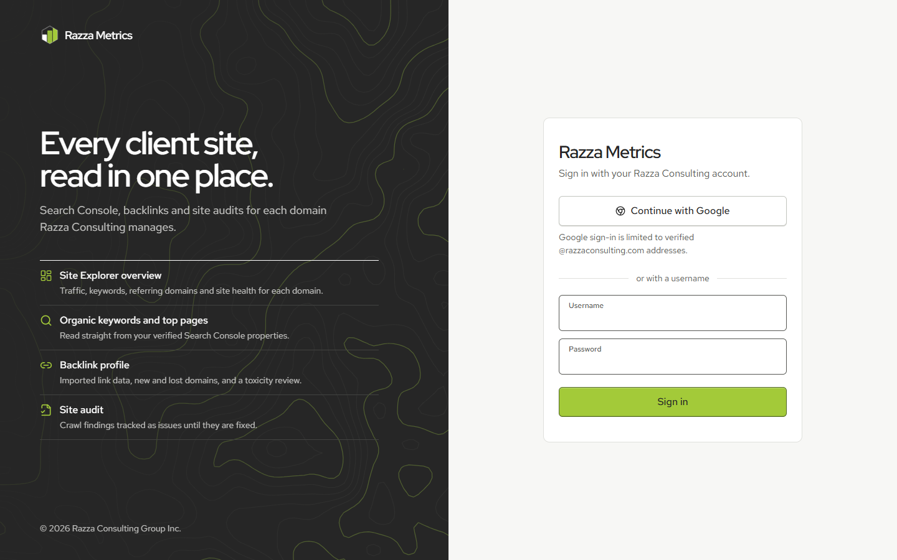
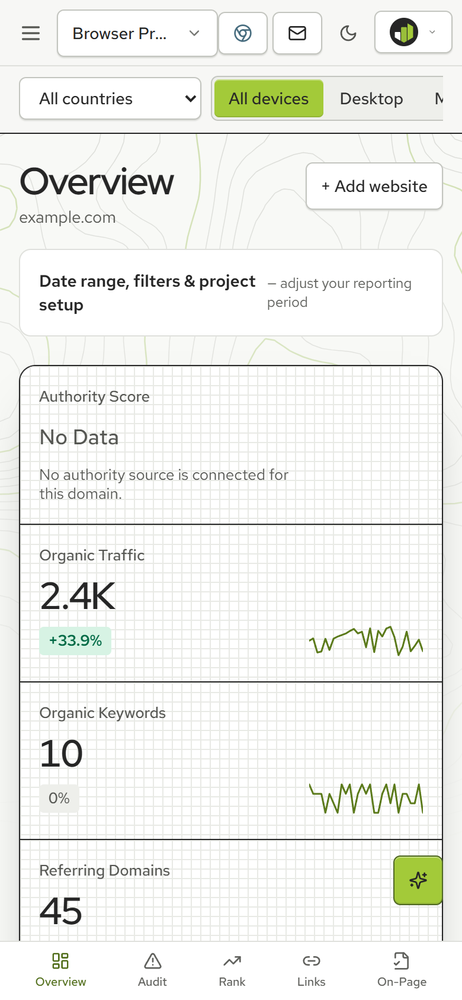

# Razza Metrics

An SEO analytics and site explorer for Razza Consulting. Pick a client domain and a period, and Razza Metrics shows how much organic search traffic it earns, which keywords and pages earn it, what its backlink profile looks like, and what the technical audit found. It reads in the same order as Ahrefs Site Explorer and Semrush Domain Overview, built on data the team owns.

**Live prototype:** [razza-metrics.razza-seo-platform.workers.dev](https://razza-metrics.razza-seo-platform.workers.dev). Sign-in is restricted to Razza Consulting accounts.



## What it does

| Screen | What you see | Data source |
| --- | --- | --- |
| **Overview** | Five headline metrics with period-over-period change and sparklines; organic traffic against keyword footprint with a crosshair tooltip; keyword position distribution; top pages and backlink velocity; device split and top countries | Google Search Console, imported backlinks, site audits |
| **Organic Keywords** | Click-through rate by position (finds keywords that rank but get few clicks); keyword winners and losers; a searchable, filterable keyword table | Google Search Console |
| **Top Pages** | Every page Google showed, ranked by clicks, with share, change, top keyword and average position; search and sort | Google Search Console |
| **Backlink Profile** | Referring domains gained and lost per week; follow vs nofollow; top anchor texts; link audit table and disavow export | Imported backlink CSVs |
| **Site Audit** | Findings per audit over time; PageSpeed performance trend with Core Web Vitals ratings; on-page checks | Built-in crawler, Google PageSpeed Insights |
| **More tools** | Keyword rank tracking, explainable backlink toxicity scores, and a persistent issue tracker with a kanban board | All of the above |

New sites get their first full site audit automatically, and Search Console data syncs daily once a property is connected.

### Screenshots

| | |
| --- | --- |
|  |  |
|  |  |
|  |  |
|  |  |



The screenshots use sample data from the local test database (`example.com`), not a real client.

## Data you can trust

Every number on screen comes from data the project stores: Search Console measurements (clicks, impressions and average position by query, page, date, device and country), imported backlink CSVs, the server-side HTML crawler and PageSpeed results. Nothing is estimated or generated. Where a metric has no source, such as domain authority or traffic value, the screen says so instead of showing a number. See [data limitations](docs/data-limitations.md).

## Tech stack

- **Frontend:** React 18, TypeScript, Vite, Tailwind CSS with a token-based design system ([DESIGN.md](DESIGN.md)); charts are plain SVG with no chart library.
- **Backend:** a Cloudflare Worker ([`server/`](server)) with a D1 (SQLite) database, background jobs and a daily cron.
- **Integrations:** Google OAuth sign-in (restricted to verified `@razzaconsulting.com` addresses), Google Search Console, PageSpeed Insights.
- **Tests:** Vitest unit and API tests, Playwright end-to-end tests.

## Getting started

Requires Node 22.12 or later.

```bash
npm install
cp .env.example .dev.vars   # then fill in the values described in docs/setup.md
npm run db:migrate
npm run build
npm run dev:server
```

Open http://localhost:8787. Sign in with Google, or with the optional username and password login: set `MANUAL_ADMIN_USERNAME` and a `MANUAL_ADMIN_PASSWORD_HASH` in `.dev.vars` as described in [setup](docs/setup.md). Never commit `.dev.vars`; it holds your secrets and is already in `.gitignore`.

| Command | What it does |
| --- | --- |
| `npm run dev:server` | Serves the built app (`dist/`) and the API on port 8787 |
| `npm run dev` | Vite with hot reload for frontend work |
| `npm run typecheck` | Type-checks the app and the Worker |
| `npm run lint` | ESLint |
| `npm test` | Unit and API tests |
| `npm run test:e2e` | Playwright tests against a separate test database on port 8788 |
| `node scripts/screenshots.mjs` | Regenerates the README screenshots (needs the test server on 8788) |
| `npm run deploy` | Deploys the Worker; see [deployment](docs/deployment.md) |

## Project layout

```
src/
  components/
    explorer/      Overview widgets, charts, context bar, shared UI
    tools/         Organic Keywords, Top Pages, Backlink Profile, Site Audit and more tools
    layout/        Sidebar, top bar, mobile navigation
    auth/          Sign-in page and its contour background
    brand/         The Razza Metrics logo
  context/         Project and auth state
  services/        API client and analytics helpers (explorer.ts)
  tokens.css       Every colour, font and spacing value
server/            Cloudflare Worker: API, auth, jobs, crawler, Google integrations
migrations/        D1 database schema
tests/             Unit, API and end-to-end tests
docs/              Setup, deployment, architecture and screenshots
```

## Documentation

- [Setup](docs/setup.md) and [Google OAuth](docs/google-oauth.md)
- [Deployment](docs/deployment.md)
- [Architecture](docs/architecture.md)
- [Data limitations](docs/data-limitations.md)
- [Design system](DESIGN.md) and [product context](PRODUCT.md)
- [Troubleshooting](docs/troubleshooting.md)

## Credits

Parts of the crawl and audit logic were adapted from [OpenSEO](https://github.com/every-app/open-seo) under the MIT licence; its notice is kept in [docs/UPSTREAM-LICENSE.txt](docs/UPSTREAM-LICENSE.txt). See [the comparison](docs/upstream-comparison.md) for what was and was not adapted.

© 2026 Razza Consulting Group Inc.
